# Báo cáo tích hợp CV → xác nhận người dùng → KB

Ngày: 14-11-2026. Bản phát hành: **Beta01**. Nhánh: `feat/soicterra-v3-frontend`. Báo cáo mô tả luồng tính năng và kết quả kiểm thử của bản Beta01.

## Luồng đã triển khai

```mermaid
flowchart LR
  A[Ảnh hoặc demo] --> B[POST /api/v1/scans]
  B --> C[Chọn detection.id hoặc tra cứu thủ công]
  B --> R[Khoanh vùng vật thể bị bỏ sót]
  R --> S[POST /api/v1/scans/region: YOLO trên crop]
  S --> C
  C --> D[Sửa nhóm vật liệu nếu cần]
  D --> E[GET /recommendations/catalog]
  E --> F[Người dùng chọn object_id]
  F --> G[GET /objects/object_id và trả lời câu hỏi]
  G --> H[POST /evaluate]
  H --> I[Hướng dẫn KB và cảnh báo an toàn]
```

`main.tsx` sở hữu ảnh, scan generation, detection đang chọn, sửa nhãn và loại trừ. `ScanStudio.tsx` dùng `scanId:detection.id` cho phiên của từng khung; phiên tra cứu thủ công có khóa riêng. `RecommendationWizard.tsx` nhận phiên được điều khiển từ ngoài, giữ `object_id`, câu trả lời và kết quả riêng cho từng khung. Đổi khung hủy request đang chờ; đổi điều kiện, vật thể hoặc nhóm vật liệu chỉ vô hiệu kết quả của khung đó. Ảnh mới tạo scan ID mới, nên detection ID được tái sử dụng không thể hiện kết quả ảnh cũ.

Sau lượt quét đầu, nút **Khoanh vật thể bị bỏ sót** cho phép kéo hình chữ nhật trực tiếp trên ảnh. Tọa độ được đổi theo `object-fit: contain`, kể cả khoảng trống viền. Backend crop ảnh đã xoay EXIF, chạy lại cùng detector trên crop và trả khung quy về tọa độ ảnh gốc. Kết quả được nối vào scan với ID mới, giữ nguyên các phiên đã hoàn thành. Nếu YOLO vẫn không thấy gì, vùng khoanh được đánh dấu **chưa nhận diện** và người dùng chọn vật thể KB thủ công; không gán nhãn AI giả. Demo không chạy YOLO thực lần hai và ghi rõ điều đó.

## Thay đổi

- `frontend/src/main.tsx`: lựa chọn theo detection ID; điều chỉnh luồng sửa nhãn và loại trừ.
- `frontend/src/components/ScanStudio.tsx`: khung và thẻ chọn từng detection, thao tác kéo để khoanh vùng vật thể bị bỏ sót, phiên riêng, CTA tra cứu thủ công, nhãn demo và thông tin độ tin cậy mô hình. Đưa Wizard và lời khuyên ra khu vực toàn chiều rộng ngay dưới panel quét, có nút đi đến từ danh sách kết quả. Bỏ mẹo xử lý theo lớp trong panel quét để yêu cầu chọn vật thể KB trước khi đưa ra hướng dẫn.
- `frontend/src/components/RecommendationWizard.tsx`: phiên điều khiển, ưu tiên ứng viên cùng nhóm nhưng luôn tìm toàn bộ 166 vật thể, lọc nhóm tùy chọn, cảnh báo khác nhóm, hiển thị đầy đủ phản hồi và nguồn KB, chặn kết quả request cũ.
- `frontend/src/components/KnowledgeSections.tsx`: thư viện KB độc lập tiếp tục có phiên tra cứu riêng.
- `frontend/src/components/ChatAssistant.tsx`, `frontend/src/lib/api.ts`, `backend/chat.py`, `.env.example`, `docs/CHATBOT_GROQ.md`: chatbot Groq (`openai/gpt-oss-20b`) gọi LLM cho mọi câu hỏi khi có key; KB làm ngữ cảnh khi khớp, mô hình trả lời bằng kiến thức chung an toàn nếu không có KB, và UI phân biệt nguồn câu trả lời.
- `backend/knowledge.json`: thêm từ khóa đồ điện tử thường gọi như loa cũ, tai nghe và radio để tra đúng hướng dẫn rác điện tử của chatbot; không sửa KB 166 vật thể.
- `frontend/src/types.ts`, `frontend/src/recommendations.css`: kiểu dữ liệu phiên/kết quả và trạng thái chọn, focus, hiển thị hướng dẫn.
- `backend/recommendation_api.py`: danh mục trả 422 khi `category_id` không có trong taxonomy. Không thêm endpoint và không đổi shape của phản hồi hợp lệ.
- `backend/main.py`, `frontend/src/lib/api.ts`: thêm `POST /api/v1/scans/region` nhận ảnh và `x1,y1,x2,y2`; áp dụng kiểm tra ảnh/khung như scan gốc và trả `ScanResponse` với tọa độ khung của ảnh đầy đủ.
- `frontend/src/lib/region.ts`, `frontend/src/lib/regionScan.ts`: đổi tọa độ kéo trên ảnh và ghép detection mới hoặc vùng thủ công vào scan cũ.
- `frontend/package.json`, `frontend/package-lock.json`, hai tệp `*.test.tsx`: Vitest và React Testing Library cùng kiểm tra tương tác và request.
- `tests/test_recommendations.py`, `tests/test_api.py`: kiểm tra nhóm danh mục không hợp lệ, crop, ánh xạ khung, vùng sai, demo và detector chưa sẵn sàng.
- `tests/test_environment_news.py`: cập nhật fixture nguồn tin thành tên miền được allowlist mới chấp nhận; không sửa implementation tin tức đang được chỉnh độc lập.

Các chỉnh sửa có sẵn/đồng thời ở `backend/data/environment_news.json`, `backend/environment_news.py`, `frontend/src/components/EnvironmentalNews.tsx`, `frontend/src/environmentNews.css` và `dev.ps1` không thuộc tích hợp này và được giữ nguyên. `backend/recommendation_kb.json`, `backend/response_catalog_v21.json`, `backend/taxonomy.json` không thay đổi. Không huấn luyện YOLO, merge hoặc deploy.

## API và tính tương thích

Các endpoint hiện hữu được dùng nguyên: `/api/v1/scans`, `/api/v1/recommendations/catalog`, `/objects/{object_id}`, `/evaluate`. Endpoint mới `/api/v1/scans/region` dùng multipart `image`, `x1`, `y1`, `x2`, `y2` theo pixel của ảnh đã xoay EXIF; phản hồi cùng shape `ScanResponse` với khung trong hệ tọa độ ảnh đầy đủ. Body đánh giá vẫn là `{object_id, answers, source, detected_category_id?}`. `source=detected` giữ nhóm gốc của YOLO; `source=corrected` cũng gửi nhóm gốc, còn `object_id` do người dùng chọn quyết định nội dung. Vùng không được nhận diện và tra cứu độc lập gửi `source=manual`. API không lưu ảnh hoặc phiên.

## Kiểm thử thực chạy

| Lệnh | Kết quả |
|---|---|
| `.\.venv\Scripts\python.exe -m pytest tests -q` | 346 passed, 1 deprecation warning |
| `npm test` trong `frontend` | 14 passed, 5 test files |
| `npm run build` trong `frontend` | TypeScript và Vite build thành công |
| `git diff --check` | Không có lỗi whitespace |
| Chat Groq qua API local | RAM cũ: assistant=groq, material_id=e_waste; phản hồi thật trong 1,8 giây |
| Chatbot với câu hỏi về RAM cũ | 6 bài test tập trung qua; API local trả `assistant=groq`, `material_id=e_waste` |

Frontend test bao phủ hai vật thể cùng nhóm, sửa/loại trừ riêng, giữ kết quả khi đổi khung, đổi đáp án chỉ xóa kết quả tương ứng, scan mới dùng lại detection ID, demo, không phát hiện, lọc và tìm toàn bộ, `urgo`, vật thể khác nhóm, phản hồi an toàn chi tiết, provenance và response đến muộn. Kiểm tra mới bao phủ kéo vùng, tọa độ ảnh có viền, ghép kết quả lượt hai và vùng không được nhận diện. Backend suite bao phủ hợp đồng scan/KB, 166 bản ghi, câu hỏi, crop/ánh xạ khung và các trường hợp nguy hiểm đã có trước đó.

## Kịch bản chấp nhận và giới hạn

S3 (release liner khác nhãn gợi ý), S4 (hai vật thể cùng nhóm), S6 (tra cứu khi không phát hiện), S8 (request cũ) và S9 (thư viện độc lập) được kiểm tra tự động ở mức component/API. S1, S2, S7 được kiểm tra bằng backend TestClient và rule-engine tests. S5 (ảnh lộn xộn với khung chồng lấn) chưa được thử bằng ảnh thực; lựa chọn qua thẻ và bàn phím đã có component test. Chưa chạy thao tác bằng trình duyệt trên điện thoại hoặc thử inference YOLO/GPU với ảnh thực trong phiên này.

Rủi ro còn lại: độ chính xác detection và vị trí khung trên ảnh thực phụ thuộc checkpoint/ảnh đầu vào; cần thử ảnh nhiều vật thể và màn hình nhỏ trong local preview. Nguồn KB là nguyên tắc chung; `local_collection_verified` vẫn `false`. Nhánh phù hợp để **preview nội bộ có giám sát** sau một lượt QA trình duyệt bằng ảnh thực, chưa nên coi là xác nhận chất lượng nhận diện hoặc tuyến thu gom địa phương.
